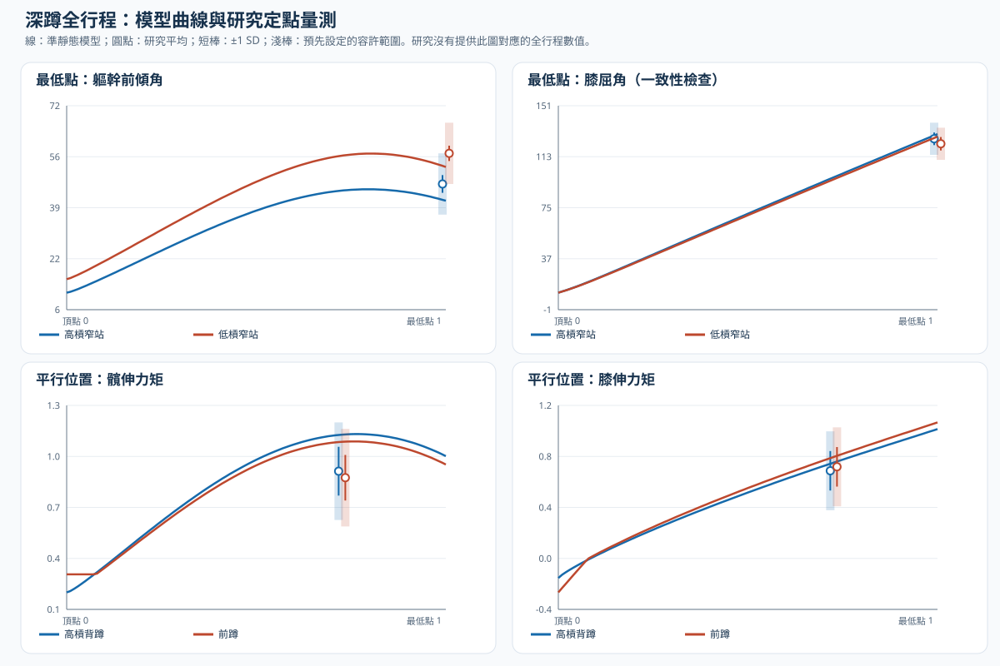

# 深蹲數值比對結果

目前模型在四篇測試研究的 **14 筆定義可比較項**中，固定 1.75 m／75 kg 身體按原絕對容許差通過 **13/14**；按研究條件抽樣的虛擬群體，以研究個體標準差為範圍通過 **7/14**（0.12.0 骨長分配後；0.11.1 為 8/14，見[骨長分配的影響](#骨長分配0120的影響)）。另有 14 筆定義不一致、3 筆探索性、4 筆事後一致性檢查，均不進分母。兩筆 Goršič 腰背伸力矩在[定義核對](squat-diagnosis.md#2-腰背伸力矩)後移出可比較分母；通過數與模型數值均未改善。兩種準則不同，不可把兩個分數當成同一指標的進退；也不能稱為預測精度。條件、抽樣與判定式見[方法](../methods.md)，逐筆機器結果見 [`validation/results.json`](../../../validation/results.json) 與 [`validation/population-results.json`](../../../validation/population-results.json)。

## 比較資料與可比性

| 研究 | 受試者與方法 | 可靠度及條件註記 |
|---|---|---|
| [Goršič 等 2020](../references.md#驗證研究) | 18 人（10 男、8 女）；前／背蹲上升期、股骨對垂直 70° 定點；以三維運動學與逆動力學量軀幹角及關節力矩。 | 原文有表列平均與個體 SD；研究的 3 cm 鞋跟**絕對高度**以模型跟趾落差代理，骨盆角因模型無獨立骨盆而不比較。 |
| [Gullett 等 2009](../references.md#驗證研究) | 15 人（9 男、6 女）；前／背蹲各用 70% 1RM，比較動態峰值膝力矩；以三台攝影機作 3D 重建。 | 背／前蹲用各自 1RM，模型按研究平均換算負重；動態峰值有慣性，本模型沒有。 |
| [Hutchison 與 Caterisano 2019](../references.md#驗證研究) | 10 名男性美式足球員；鋼槓背蹲、30% 個人 1RM、約每分鐘 52 次，量雙側推定峰值。 | 平均 1RM 公斤數未報；模型只到方法規定的膝屈 80° 下限，研究觀察均值約 89°。三筆力矩僅探索，不納入分數。 |
| [Larsen 等 2021](../references.md#驗證研究) | 18 人（9 男、9 女）；高／低槓、窄／寬站的 3RM，表列軀幹與關節角。 | 模型深度與站距是外觀標記代理。髖角採不同骨盆座標、踝角缺可換算的站立參考，因此只比軀幹角；四筆膝角只作深度一致性檢查。高槓窄站的早期設定獨立性未證。 |

姿勢策略的校準資料另取 [Demers 等 2018](../references.md#校準研究) 的 32 人（20 男、12 女）赤足、無外加負重背蹲圖讀六點，不納入上列測試分母。固定身體重算及群體診斷的六點都在 ±2° 讀圖範圍；固定股骨 20°／40° 事件下模型踝角群體 SD 為 **0°**；60° 事件下中／寬站為 **0.73°／0.90°**，因極端身材的足中段平衡補救會增加小腿前傾。這些分散度是模型策略，不是真實個體變異。

四篇測試研究未提供可重建的水平膝路徑，因此比對條件均採教練指定的 `forward` 預設，不把它當作研究實測條件。高槓預設站距的腳尖外開約 17°、膝路徑 0°；保留現有腳尖角作示範，因[技術原則](../technique-principles.md)只要求小幅外開，[Asayama 等 2021](https://pubmed.ncbi.nlm.nih.gov/34717162/)沒有提供可直接套用的最佳角度。腳尖角數值未用測試組重新校準。

## 兩種膝路徑的數值對照

四篇測試研究都未報告可重建的水平膝路徑。`forward`（膝朝正前方）是教練指定的產品預設；`toes`（膝跟腳尖）是同一模型的替代設定。以下兩組都只是模型敏感度對照，**不能推斷研究受試者實際採用哪一條膝路徑**。測試條件、研究值、固定容許差與群體判定式相同，只有 `kneePath` 不同。

固定身體 14 筆可比較項：正前方 **13/14**、跟腳尖 **9/14**；群體準則：正前方 **8/14**、跟腳尖 **5/14**。分研究看，Goršič 固定 8/8／7/8、群體 4/8／5/8；Gullett 固定 1/2／0/2、群體 1/2／0/2；Larsen 固定 4/4／2/4、群體 3/4／0/4。Hutchison 三筆僅探索，無可比較通過率。斜線前後依序為正前方／跟腳尖。兩筆腰背診斷值仍在下表展示，但定義不一致，不納分母。

Goršič 力矩單位為 Nm/(kg·m)，Gullett 膝峰為 Nm/kg；Hutchison 峰值為雙側 Nm，軀幹為度。群體欄顯示模型平均 ± 模型個體 SD，研究欄顯示研究平均 ± 個體 SD；固定身體以原絕對容許差判定。Hutchison 三筆因平均 1RM 公斤數未報而列探索，不算通過率。

| 研究與指標 | 固定：正前方 | 固定：跟腳尖 | 群體：正前方 | 群體：跟腳尖 | 研究平均 ± SD |
| --- | ---: | ---: | ---: | ---: | ---: |
| Goršič 背蹲軀幹 ° | 44.14 通過 | 43.13 通過 | 44.78 ± 5.30 失敗 | 43.76 ± 5.29 通過 | 37.90 ± 6.40 |
| Goršič 背蹲腰背伸（5 cm 點） | 2.08 定義不一致 | 2.03 定義不一致 | 2.06 ± 0.20 定義不一致 | 2.02 ± 0.21 定義不一致 | 1.53 ± 0.25 |
| Goršič 背蹲髖伸 | 1.18 通過 | 1.15 通過 | 1.17 ± 0.11 失敗 | 1.15 ± 0.12 失敗 | 0.93 ± 0.15 |
| Goršič 背蹲膝伸 | 0.67 通過 | 0.73 通過 | 0.68 ± 0.04 通過 | 0.74 ± 0.04 通過 | 0.67 ± 0.15 |
| Goršič 背蹲踝蹠屈 | 0.31 通過 | 0.31 通過 | 0.31 ± 0.02 通過 | 0.31 ± 0.02 通過 | 0.28 ± 0.11 |
| Goršič 前蹲軀幹 ° | 28.80 通過 | 27.77 失敗 | 29.30 ± 5.09 失敗 | 28.26 ± 5.10 失敗 | 40.60 ± 5.70 |
| Goršič 前蹲腰背伸（5 cm 點） | 2.08 定義不一致 | 2.03 定義不一致 | 2.06 ± 0.20 定義不一致 | 2.01 ± 0.20 定義不一致 | 1.64 ± 0.27 |
| Goršič 前蹲髖伸 | 1.14 通過 | 1.11 通過 | 1.13 ± 0.12 失敗 | 1.10 ± 0.12 失敗 | 0.89 ± 0.14 |
| Goršič 前蹲膝伸 | 0.71 通過 | 0.77 通過 | 0.73 ± 0.05 通過 | 0.79 ± 0.04 通過 | 0.70 ± 0.15 |
| Goršič 前蹲踝蹠屈 | 0.31 通過 | 0.31 通過 | 0.31 ± 0.02 通過 | 0.31 ± 0.02 通過 | 0.25 ± 0.11 |
| Gullett 背蹲膝伸峰 | 1.27 通過 | 1.67 失敗 | 1.24 ± 0.11 通過 | 1.65 ± 0.11 失敗 | 1.00 ± 0.40 |
| Gullett 前蹲膝伸峰 | 1.22 失敗 | 1.58 失敗 | 1.20 ± 0.10 失敗 | 1.56 ± 0.10 失敗 | 0.70 ± 0.20 |
| Hutchison 背蹲髖伸峰 | 353.76 探索 | 334.31 探索 | 443.20 ± 89.84 探索 | 420.18 ± 86.18 探索 | 324.00 ± 52.00 |
| Hutchison 背蹲膝伸峰 | 113.83 探索 | 149.66 探索 | 146.34 ± 31.10 探索 | 189.04 ± 38.34 探索 | 157.00 ± 34.00 |
| Hutchison 背蹲踝蹠屈峰 | 94.10 探索 | 94.09 探索 | 114.24 ± 21.77 探索 | 114.23 ± 21.77 探索 | 90.00 ± 24.00 |
| Larsen 高槓窄站軀幹 ° | 42.63 通過 | 41.22 通過 | 42.70 ± 4.56 失敗 | 41.28 ± 4.61 失敗 | 46.70 ± 2.90 |
| Larsen 高槓寬站軀幹 ° | 43.10 通過 | 31.55 失敗 | 43.19 ± 5.59 通過 | 31.18 ± 6.30 失敗 | 46.00 ± 3.40 |
| Larsen 低槓窄站軀幹 ° | 53.92 通過 | 52.24 通過 | 54.38 ± 5.89 通過 | 52.67 ± 5.87 失敗 | 56.70 ± 2.50 |
| Larsen 低槓寬站軀幹 ° | 54.54 通過 | 41.50 失敗 | 55.13 ± 7.34 通過 | 41.42 ± 7.37 失敗 | 53.00 ± 4.40 |

「膝跟腳尖」欄為相同研究條件、相同判定準則下改用 `kneePath: toes` 的對照值；正式結果檔 `validation/results.json` 與 `validation/population-results.json` 採教練指定的正前方預設。

預設高槓深蹲最低點的[正面](knee-forward-front.png)與[側面](knee-forward-side.png)畫面顯示膝沿正前方移動、腳尖小幅外開；側面可看到小腿前傾與全腳接觸。這是模型視覺檢查，不代表真實脛股旋轉或關節應力。

曲線是模型行程，研究多為特定事件值；模型 `e` 不是研究動作時間百分比。圖中膝角只檢查深度近似，並非獨立通過項。

## 主要差異與可能原因

- **前蹲軀幹群體偏直立。** Goršič 定點模型 28.80°、研究 40.6°；群體平均 29.30° 仍不在研究個體 SD 內。固定身體按原 12° 容許差通過，不能以此掩蓋群體差距。前槓位置與 40°／16° 小腿端點的局部敏感度見[診斷](squat-diagnosis.md#1-前蹲軀幹)；沒有獨立同條件資料可重新校準。
- **腰背定義不同，髖需求群體偏高。** Goršič 下背力矩在髂嵴中點的骨盆遠端座標系；模型預設在髖上沿軀幹 5 cm 取矩（0.10.4 的髂嵴點對照見下，仍缺骨盆自由度），因此兩式數值雖高，不能按原門檻判為誤差。髖伸在較寬的固定容許差內通過，但群體平均超過研究 SD。單一剛體軀幹、固定重心及槓位、外觀標記換算與準靜態差異均可能影響力臂；[診斷](squat-diagnosis.md#2-腰背伸力矩)未證明單一因素是主因。
- **前蹲膝峰仍偏高；寬站軀幹差距縮小。** Gullett 背／前蹲膝峰 1.27／1.22，對研究 1.00／0.70 Nm/kg；背蹲已在原容許範圍，前蹲仍超過。Larsen 高／低槓寬站的模型軀幹為 43.10°／54.54°，對研究 46.0°／53.0°，均通過原容許差。膝路徑改變股骨水平外展與矢狀投影，可能是主因，但骨盆、站距與深度代理仍未對齊；未以測試組反調。
- **鞋跟分配影響判定。** `HEEL_SHANK_SHARE=0.5` 未有同條件量測；預設 0.5 有三筆敏感通過。以 0、0.25、0.5、0.75、1 掃描時，固定身體總通過數為 11、13、13、12、13／14；不同值只是敏感度，不代表可選最有利的係數。

### 腰背取矩點對照（0.10.4）

Goršič 的下背點是左右髂嵴中點。表中 5 cm 列保留產品預設；下表以 `iliacCrest` 點（髖上 9.15% 身高，1.75 m 男性 16.0 cm，[來源](../lumbar-point.md)）重算，單位 Nm/(kg·m)，兩筆仍是 `definition-mismatch`，不進通過率。

| 指標 | 固定：正前方 5 cm → 髂嵴點 | 固定：跟腳尖 5 cm → 髂嵴點 | 群體：正前方 5 cm → 髂嵴點 | 研究平均 ± SD |
| --- | ---: | ---: | ---: | ---: |
| 背蹲腰背伸 | 2.08 → 1.46 | 2.03 → 1.42 | 2.06 → 1.44 ± 0.16 | 1.53 ± 0.25 |
| 前蹲腰背伸 | 2.08 → 1.65 | 2.03 → 1.62 | 2.06 → 1.63 ± 0.14 | 1.64 ± 0.27 |

- 取點由 5 cm 移到 16 cm，使固定身體值下降約 0.62（背蹲）／0.43（前蹲）Nm/(kg·m)，每公尺取矩點位移的斜率為 −5.6／−3.9（力矩對取矩點位置為線性）。審查原先估計的下降 0.15–0.3 偏小，因為 ANSUR II 髂嵴點（約 16 cm）比預估的 8–12 cm 高。
- 髂嵴高度的個體差（ANSUR 男性比例 SD 0.0123，約 ±2.2 cm）造成背蹲約 ±0.12、前蹲約 ±0.08 Nm/(kg·m) 的範圍。
- 數值接近研究平均（1.53、1.64）**不是**改回可比較的理由，也不是通過；歸類在比較前已訂。剩餘差異：研究點固定在骨盆，模型沒有骨盆自由度，點只能沿軀幹軸；兩者方向在深蹲底部可差數十度，取矩點前後位置可差數公分，而力矩斜率約 4–6 Nm/(kg·m)/m，每 1 cm 約 0.04–0.06。需先有骨盆自由度（且不能用研究的骨盆角當輸入）才能消除。

群體大腿長單獨移動來源性別分布的 ±1 SD 時，背蹲腰背伸診斷值約 1.89–2.23 Nm/(kg·m)，因定義不一致不作通過判定；前蹲軀幹約 25.60–33.23°，仍未進入研究 ±1 SD 範圍；高槓寬站軀幹約 39.09–47.50°，已與研究範圍相交。單靠目前骨長代理分布不能消除前蹲角度差距。

## 判讀界線

模型群體的軀幹角 SD 約 4.56–7.34°，是**抽樣與模型**造成的分散，不能當作研究受試者變異的實測分解。ANSUR II 軍人比例、研究整體身高體重邊際分布、標記到關節中心的代理換算，以及身高相關性未保留，均限制群體推論。Hutchison 的未知公斤負重與雙腿合計推定保持探索性；Larsen 高槓窄站固定身體雖通過，其早期設定獨立性仍未證。肌肉分配與 EMG 指標不同，本表沒有驗證個人肌力或肌肉活化。[限制與已知問題](../limitations.md)列出其餘動作的模型問題。

## 骨長分配（0.12.0）的影響

0.12.0 起深蹲與高腳杯的小腿角在預設身體的策略上依骨長加偏移，與軀幹分攤（方法見[方法](../methods.md)、方案比較見[姿勢隨骨長改變](../anatomy-posture-plan.md)）；λ = 1 是「教學示範選擇，無文獻來源（教練確認 2026-11-28）」，**不依本頁任何結果調整**。固定 1.75 m／75 kg 預設身體逐值短路：固定身體 **13/14 不變**，`validation/results.json` 只有版本號改變。群體驗證深蹲三篇 8/14 → **7/14**，全體 27/69 → 26/69；唯一翻轉為 Larsen 低槓窄站軀幹（群體平均 54.38° → 53.96°，研究 56.7 ± 2.5°，門檻約 54.2°，邊界翻轉）。

模型群體的軀幹角 SD 由 4.6–7.3° 降為 2.1–2.5°，小腿（踝）角 SD 由 0° 升為約 2–3°：分攤把變異從軀幹移到小腿，不是總變異增加。研究的軀幹 SD 為 2.5–6.4°，模型 SD 小於實測個體 SD 是預期的（技術選擇與活動度差異不在模型內）；這不是調整 λ 的依據。下表為 `forward` 膝路徑、同一虛擬群體的前後對照（前＝0.11.1，後＝0.12.0；`toes` 路徑的對照表與上方原表其餘群體欄為 0.11.1 數值，未重算）。

| 指標 | 0.11.1 群體（模型平均 ± SD） | 0.12.0 群體 | 研究平均 ± SD |
|---|---|---|---|
| gorsic-2020/straight-back/trunk | 44.78 ± 5.30 失敗 | 44.31 ± 2.10 失敗 | 37.9 ± 6.4 |
| gorsic-2020/straight-back/lumbar | 1.44 ± 0.16 定義不一致 | 1.43 ± 0.09 定義不一致 | — |
| gorsic-2020/straight-back/hip | 1.17 ± 0.11 失敗 | 1.17 ± 0.05 失敗 | 0.93 ± 0.15 |
| gorsic-2020/straight-back/knee | 0.68 ± 0.04 通過 | 0.69 ± 0.08 通過 | 0.67 ± 0.15 |
| gorsic-2020/straight-back/ankle | 0.31 ± 0.02 通過 | 0.31 ± 0.02 通過 | 0.28 ± 0.11 |
| gorsic-2020/straight-front/trunk | 29.30 ± 5.09 失敗 | 28.94 ± 2.11 失敗 | 40.6 ± 5.7 |
| gorsic-2020/straight-front/lumbar | 1.63 ± 0.14 定義不一致 | 1.62 ± 0.09 定義不一致 | — |
| gorsic-2020/straight-front/hip | 1.13 ± 0.12 失敗 | 1.12 ± 0.06 失敗 | 0.89 ± 0.14 |
| gorsic-2020/straight-front/knee | 0.73 ± 0.05 通過 | 0.73 ± 0.08 通過 | 0.7 ± 0.15 |
| gorsic-2020/straight-front/ankle | 0.31 ± 0.02 通過 | 0.31 ± 0.02 通過 | 0.25 ± 0.11 |
| gullett-2009/back/peak-knee | 1.24 ± 0.11 通過 | 1.23 ± 0.17 通過 | 1 ± 0.4 |
| gullett-2009/front/peak-knee | 1.20 ± 0.10 失敗 | 1.19 ± 0.15 失敗 | 0.7 ± 0.2 |
| larsen-2021/high-narrow/trunk | 42.70 ± 4.56 失敗 | 42.58 ± 2.24 失敗 | 46.7 ± 2.9 |
| larsen-2021/high-wide/trunk | 43.19 ± 5.59 通過 | 42.99 ± 2.48 通過 | 46 ± 3.4 |
| larsen-2021/low-narrow/trunk | 54.38 ± 5.89 通過 | 53.96 ± 2.14 失敗 | 56.7 ± 2.5 |
| larsen-2021/low-wide/trunk | 55.13 ± 7.34 通過 | 54.51 ± 2.32 通過 | 53 ± 4.4 |

Demers 校準診斷（六個圖讀點）的身體映射同步對齊（見[方法](../methods.md#校準組測試組與判定)）：0.12.0 的分攤搭配**舊映射**（把外觀標記長度直接當關節中心長度）六點平均降 1.6–5.0°，僅 2/6 在 ±2° 內（6.91／11.89／16.41／6.11／10.47／14.47°）；改為與群體模擬相同的 ANSUR 比例映射後 **6/6** 在 ±2° 內（8.93／15.61／21.69／8.08／14.11／19.86°，個體 SD 1.6–4.6°）。校準值（dom、站距係數、行程指數、圖讀點）沒有改。固定身體 Demers 六點仍為 6/6。

Demers 平均身體（無個體變異）的換算敏感度，由 `node tools/diagnose-anatomy-posture.mjs` 重現（誤差 = 模型 − 圖讀；方案 A，λ = 1）：

| 身體 | Lt／Ls／Ltr | medium 20° | medium 40° | medium 60° | wide 20° | wide 40° | wide 60° | ±2° 內 |
|---|---|---:|---:|---:|---:|---:|---:|---:|
| 預設身體 | 0.440／0.394／0.518 | 0.6 | -1.3 | 0.3 | 0.5 | -1.4 | -0.2 | 6/6 |
| ANSUR 映射 | 0.432／0.378／0.520 | 0.6 | -1.3 | 0.3 | 0.6 | -1.4 | -0.2 | 6/6 |
| 半途映射 | 0.416／0.389／0.530 | -0.0 | -2.4 | -1.4 | -0.0 | -2.6 | -2.0 | 4/6 |
| 外觀標記長度直接用 | 0.400／0.400／0.540 | -0.6 | -3.6 | -3.1 | -0.6 | -3.7 | -3.6 | 2/6 |

**性質與界線**：這是「對換算方式敏感的一致性檢查，不是獨立驗證」。Demers 圖讀六點本來就是校準資料，再用它檢查同一個策略沒有獨立性。六點是否都在 ±2° 內取決於外觀標記長度怎麼換成模型關節中心長度：ANSUR 映射 6/6，外觀標記長度直接用 2/6，半途映射 4/6（一點在 −2.0° 邊界）。ANSUR 映射下的 Demers 平均身體（Lt 0.432、Ls 0.378、Ltr 0.520 m）幾乎就是預設身體（0.440、0.394、0.518 m），所以 6/6 主要確認方案 A 讓近預設身體的姿勢維持不變，不是證明方案預測了 Demers 的個體差異。`bodyFromRow` 的係數（預設骨架長度／ANSUR 男性平均標記長度）是假設的每節段固定比例，**不是量測的幾何換算**（關節中心與外觀標記之間沒有逐人影像驗證）。**先後順序要說清楚**：我們是在看到舊映射下 2/6 的結果之後才把映射對齊的；對齊的原則理由是其他研究自 1b21e4c 起都用 `bodyFromRow`，Demers 區塊是唯一不一致的一段，但這個選擇不是在不知道結果的情況下事先訂的。校準值（圖讀點、dom、站距係數、行程指數）沒有改，舊映射的結果另存於 `validation/population-results.json` 的 `demersRawLandmark`。

