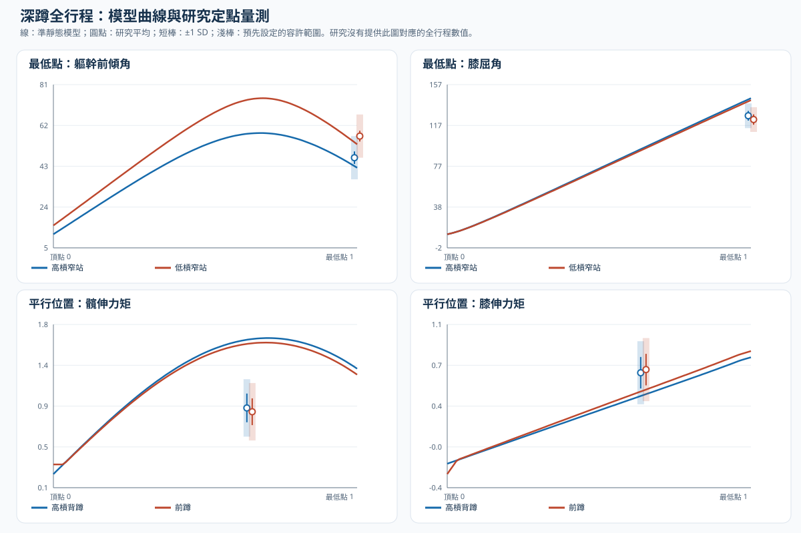

# 深蹲數值比對：T16b 方法修正

2026-11-24，產品版本 0.7.2。研究數值與容許誤差事先固定於 `0df5506`、`cb666ff`；依研究方法修正條件於 `f88f525` 單獨提交後，才重新計算。產品模型及回歸基準未修改。逐筆機器結果在 [`validation/results.json`](../../validation/results.json)，全清單層級狀態在 [`src/validation-status.json`](../../src/validation-status.json)。

## 研究條件與推導

| 研究 | 方法與本次設定 | 尚未對齊的條件 |
|---|---|---|
| [Larsen 等，2021，表 1–3](https://pmc.ncbi.nlm.nih.gov/articles/PMC8440835/) | 18 人，四種槓位與站距各做 3RM。依 IPF 髖頂低於膝且腿後側觸帶，取模型大腿略低水平約 95°：`γ底=70°+48°×depth`，所以 `depth=(95−70)/48≈0.52`；四式同用。站距取研究腳跟距 31.7／59.8 cm 對應模型 `stance=0.14／0.80`。槓重依表 2：99.2、92.9、102.5、95.6 kg，分別除研究平均體重 76.2 kg 輸入。 | 95° 是將 IPF 外觀規則轉成股骨中心線角的近似；帶高及髖部外形未知。摘要把低槓寬站寫 97.1 kg，表 2 為 95.6 kg，依表值。 |
| [Goršič 等，2020／2024，方法與表 2](https://pmc.ncbi.nlm.nih.gov/articles/PMC8106690/) | 18 人，前／背蹲同用前蹲 1RM 的 70%；原文報 1RM 91.2±31.5 kg，個人 1RM/體重平均 1.2±0.3，故取 `0.70×1.2=0.84×體重`。兩者都在上升期股骨對垂直 70° 處抽樣；站距用髖寬近似，最低點約略低水平。 | 91.2×0.70=63.84 kg，若再除群體平均 72.6 kg 得 0.88；與個人比值平均 0.84 不同，不能混作相同統計量。原文用 3 cm 鞋跟，模型無此參數。 |
| [Gullett 等，2009，方法與結果](https://paleostrengthconditioning.weebly.com/uploads/2/6/3/0/26307353/gullet_et_al_2009_-_j_strength__conditioning_research.pdf) | 15 人，各式 70% 1RM；背蹲 61.8 kg／69.7 kg ≈0.887×體重，前蹲 48.5／69.7≈0.696×體重。約肩寬、大腿平行；模型 `stance=0.30`、`depth=0.55`（大腿約 96.4°），取全行程最大正膝力矩。 | 研究動態峰值含慣性；模型準靜態。 |
| [Hutchison 與 Caterisano，2019，方法與表 2](https://pmc.ncbi.nlm.nih.gov/articles/PMC6724600/) | 10 名美式足球員，鋼槓 30% 個人 1RM、每分鐘 52 次、膝屈最低須 >80°；表 2 觀察平均 89±8°。比較器按方法下限把峰值搜尋止於模型首次達 80° 的姿勢，**未用 89° 反推深度**。 | 平均 1RM 公斤數及站距未報，保留負重未知；80° 是方案下限而非受試者實際 89°，因此只能探索。單塊測力板量到 1077 N 整體反力，配合雙側標記，表 2 力矩推定為雙腿合計，模型單側乘 2；原文未明示合計方式。 |

每一條件的詳細來源推導在 `validation/*.json` 的 `conditionDerivation`。暫時負重覆寫只作用於驗證器，運算結束即還原 `BAR_RATIO.squat`。

## 計數方法

31 筆原始參考值中，16 筆定義可比較：**9 通過、7 失敗**。另有 8 筆 `definition-mismatch`、3 筆 `exploratory`、4 筆 `consistency-check`，均不進分母。T16 的 9/31 是把不相容定義及動態探索一起計數，不能當作模型準確率；本次 9/16 也只是預設門檻下的比對摘要，不能當作預測精度。`pass` 僅依事先固定的絕對誤差門檻；文獻 SD 只用於呈現。

曲線為準靜態模型的姿勢行程；研究只有特定事件值。圖中的膝角面板是深度一致性檢查，不計入通過率。模型位置比例 `e` 不能等同研究時間比例。

## 逐筆修正前後

數值欄為模型值／當時狀態；文獻平均保留原文值（Larsen 踝角仍為原始內角），各行單位見機器結果；定義不可比的行不計算差距。容許誤差全程未改。

| 研究／條件／指標 | T16 模型／狀態 | T16b 模型／狀態 | 文獻原值 | 容許 |
|---|---:|---:|---:|---:|
| `gorsic-2020/straight-back/trunk` | 56.39／失敗 | 54.76／失敗 | 37.90 | ±12 |
| `gorsic-2020/straight-back/lumbar` | 2.90／失敗 | 2.51／失敗 | 1.53 | ±0.35 |
| `gorsic-2020/straight-back/hip` | 1.65／失敗 | 1.43／失敗 | 0.93 | ±0.3 |
| `gorsic-2020/straight-back/knee` | 0.46／通過 | 0.49／通過 | -0.67 | ±0.3 |
| `gorsic-2020/straight-back/ankle` | 0.37／通過 | 0.34／通過 | 0.28 | ±0.2 |
| `gorsic-2020/straight-front/trunk` | 41.22／通過 | 39.58／通過 | 40.60 | ±12 |
| `gorsic-2020/straight-front/lumbar` | 2.89／失敗 | 2.49／失敗 | 1.64 | ±0.35 |
| `gorsic-2020/straight-front/hip` | 1.60／失敗 | 1.38／失敗 | 0.89 | ±0.3 |
| `gorsic-2020/straight-front/knee` | 0.50／通過 | 0.53／通過 | -0.70 | ±0.3 |
| `gorsic-2020/straight-front/ankle` | 0.37／通過 | 0.34／通過 | 0.25 | ±0.2 |
| `gullett-2009/back/peak-knee` | 1.57／失敗 | 1.48／通過 | 1.00 | ±0.5 |
| `gullett-2009/front/peak-knee` | 1.68／失敗 | 1.41／失敗 | 0.70 | ±0.4 |
| `hutchison-2019/steel-back/peak-hip` | 202.74／失敗 | 384.68／探索性 | 324.00 | ±100 |
| `hutchison-2019/steel-back/peak-knee` | 117.56／通過 | 123.88／探索性 | 157.00 | ±70 |
| `hutchison-2019/steel-back/peak-ankle` | 46.89／通過 | 93.77／探索性 | 90.00 | ±50 |
| `larsen-2021/high-narrow/trunk` | 42.05／通過 | 46.28／通過 | 46.70 | ±10 |
| `larsen-2021/high-narrow/hip` | 155.25／失敗 | 141.24／定義不可比 | 111.00 | ±12 |
| `larsen-2021/high-narrow/knee` | 143.40／失敗 | 125.88／一致性檢查 | 126.40 | ±12 |
| `larsen-2021/high-narrow/ankle` | 31.12／失敗 | 31.12／定義不可比 | 106.00 | ±12 |
| `larsen-2021/high-wide/trunk` | 32.03／失敗 | 35.01／失敗 | 46.00 | ±10 |
| `larsen-2021/high-wide/hip` | 145.23／失敗 | 129.97／定義不可比 | 110.40 | ±12 |
| `larsen-2021/high-wide/knee` | 133.85／失敗 | 121.55／一致性檢查 | 119.30 | ±12 |
| `larsen-2021/high-wide/ankle` | 28.80／失敗 | 28.80／定義不可比 | 98.60 | ±12 |
| `larsen-2021/low-narrow/trunk` | 52.91／通過 | 58.86／通過 | 56.70 | ±10 |
| `larsen-2021/low-narrow/hip` | 166.11／失敗 | 153.82／定義不可比 | 110.50 | ±12 |
| `larsen-2021/low-narrow/knee` | 141.52／失敗 | 123.95／一致性檢查 | 122.70 | ±12 |
| `larsen-2021/low-narrow/ankle` | 29.18／失敗 | 29.18／定義不可比 | 106.30 | ±12 |
| `larsen-2021/low-wide/trunk` | 41.78／失敗 | 45.76／通過 | 53.00 | ±10 |
| `larsen-2021/low-wide/hip` | 154.98／失敗 | 140.72／定義不可比 | 111.90 | ±12 |
| `larsen-2021/low-wide/knee` | 132.38／失敗 | 119.70／一致性檢查 | 120.30 | ±12 |
| `larsen-2021/low-wide/ankle` | 26.68／失敗 | 26.68／定義不可比 | 100.50 | ±12 |

## 比對設定問題（已修正）

- Larsen 舊 `depth=0.90` 讓大腿角達 113.2°，比 IPF 操作規則的略低水平近似深很多；修為 0.52 後，四個模型膝角為 125.88°、121.55°、123.95°、119.70°，接近表 3 的 126.4°、119.3°、122.7°、120.3°。這是**事後一致性檢查**，不能把四筆算成獨立通過。
- Goršič 原先誤寫「平均負重未報」。試驗的百分比、前蹲 1RM 與相對體重強度已報；本次以 0.84×體重比較。Gullett 兩式分別輸入 0.887、0.696×體重。Larsen 四式按研究 3RM 輸入。產品預設仍為 1.0×體重。
- Hutchison 的單側模型輸出按**推定**雙腿合計乘 2，且只掃描到研究方法給的膝屈 80° 下限。這三筆列探索性，不計成通過或失敗。

## 定義不可比

Larsen 四筆髖屈採骨盆—大腿 Cardan 角；模型只有軀幹—大腿角、沒有獨立骨盆，故不能直接比。四筆踝角沒有站立參考，以 90° 中立轉換的假設未經證實，也不能直接比。前者需新增骨盆自由度或取可同定義的原始標記；後者需站立參考，或預先定義並改比窄／寬站之間的角度變化量。[Larsen 方法與表 3](https://pmc.ncbi.nlm.nih.gov/articles/PMC8440835/)

## 真正的模型差異

- Goršič 股骨 70° 定點：背蹲軀幹前傾 54.76°，研究 37.9°，多 16.86°，超出 ±12°。前蹲軀幹 39.58° 對 40.6°，顯示後述前蹲力矩偏差不能歸因於前傾角。[Goršič 表 2](https://pmc.ncbi.nlm.nih.gov/articles/PMC8106690/)
- 在負重對齊後，背／前蹲髖伸力矩 1.43／1.38，研究 0.93／0.89；中央腰背伸 2.51／2.49，研究 1.53／1.64，單位均為 Nm/(kg·m)。比例約 1.5–1.6，四筆仍超原門檻。[Goršič 表 2](https://pmc.ncbi.nlm.nih.gov/articles/PMC8106690/)
- Larsen 高槓寬站軀幹 35.01°，研究 46.0°，模型偏直立 10.99°，略超 ±10°。模型原有註記指出寬站股骨外展縮短矢狀投影，固定壓力中心後使軀幹偏直立；這是待驗證的幾何假設。[Larsen 表 3](https://pmc.ncbi.nlm.nih.gov/articles/PMC8440835/)、[模型註記](../../src/biomech.js)

髖與腰背力矩偏高的**有出處待檢假設**：Goršič 用分開的軀幹／骨盆參考座標及 de Leva 節段參數，且作者指出合併軀幹與骨盆會改變角度解讀；本模型只有單一剛體軀幹與估計節段質量，可能改變質心及力矩分配。原研究亦指出負重前後位置會改變槓到腰背與髖的力臂，模型的固定槓相對軀幹位置值得量測核對。研究以逆動力學處理 2 秒上升期，本模型準靜態沒有慣性項，但定點速度／加速度未報，不能推定這是全部約 1.5 倍差距的原因。[Goršič 方法、討論](https://pmc.ncbi.nlm.nih.gov/articles/PMC8106690/)

## 不確定

- Gullett 前蹲膝伸峰值模型 1.41、研究 0.70 Nm/kg，仍超 ±0.40。背蹲 1.48 對 1.00 進入 ±0.50。標為**來源可疑**：Gullett 前蹲 0.70 Nm/kg 與 Goršič 前蹲定點約 `0.70×1.75≈1.23 Nm/kg` 相差約 1.7 倍，但事件、受試者與軸定義不同，不能裁定哪一方錯。Gullett 原文用了三台攝影機與 3D 重建，不能概括為「2D 研究」；節段質量與慣量確實由平均參數估計。[Gullett 方法與結果](https://paleostrengthconditioning.weebly.com/uploads/2/6/3/0/26307353/gullet_et_al_2009_-_j_strength__conditioning_research.pdf)、[Goršič 表 2](https://pmc.ncbi.nlm.nih.gov/articles/PMC8106690/)
- Hutchison 三筆雙側推定、未知平均公斤負重、80° 方法下限對 89° 觀察均值、快速動態對準靜態，使其全部維持 `exploratory`。改換後模型髖／膝／踝為 384.68／123.88／93.77 Nm，研究 324／157／90 Nm；不將容許範圍內數值計成通過。[Hutchison 方法與表 2](https://pmc.ncbi.nlm.nih.gov/articles/PMC6724600/)
- 低槓目前只有兩筆可比較軀幹角且通過，缺同定義的定點力矩；前蹲的單筆軀幹角通過，不能外推到全行程。其他 60 個清單項目無本試點的數值比較。肌肉活化與模型分配指標也不同，不得稱已數值驗證。

## 清單層級狀態

| 清單項目 | 運動學 | 力矩 | 肌肉分工 |
|---|---|---|---|
| 高槓 | `failed`，1/3 可比較；另 4 定義不可比、2 一致性檢查 | `failed`，3/5；另 3 探索性 | `failed`，定性趨勢 7/8 |
| 低槓 | `partial`，2/2；另 4 定義不可比、2 一致性檢查 | `unvalidated` | `partial`，定性趨勢 1/1 |
| 前蹲 | `partial`，1/1 | `failed`，2/5 | `unvalidated` |

層級狀態只由可比較的數值筆數計算；肌肉層另顯示定性檢查，不能視為實測肌力驗證。後續需取得匹配槓位、負重、深度、骨盆標記與左右側別的原始試驗，才可縮小剩餘不確定性。
